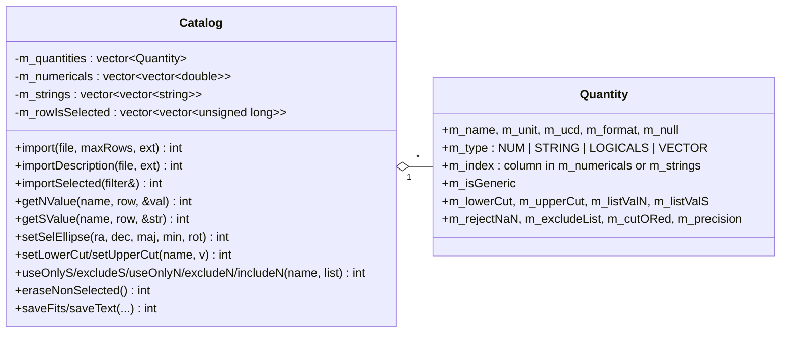

# catalogAccess Architecture

**catalogAccess** is a small, self-contained C++ library (the "U9" component
of the original GLAST design) that loads an astronomical source catalog into
memory as a set of named columns ("quantities"), lets the caller select rows
by sky region and by cuts on column values, and can write the result back out
as a FITS binary table or a VizieR-style text file. Its only consumer is
`sourceIdentify` (`gtsrcid`), which uses the loading and value-access half
only.

The code was written in 2004–2006 (A. Sauvageon) and has had only build and
packaging changes since. `src/mainpage.h` describes the original
requirements ("select a catalog name from a predefined list", "import from
the web"). Most of that never got past placeholders; see
[Purpose and scope](#purpose-and-scope).

## Purpose and scope

**Does:**
- Read a catalog from a **FITS table** (binary or ASCII extension, any HDU,
  through `tip`) or from a **VizieR text export** (TSV or `;`-separated CSV
  with VizieR's `#RESOURCE=`, `#Name:`, `#Title:` and `#Column` header
  lines).
- Hold the catalog in memory as a vector of `Quantity` descriptors plus
  column-major arrays of doubles (`NUM`) and strings (`STRING`, `LOGICALS`).
- Identify "generic" quantities (object name, RA, Dec, position error, l, b)
  either from a built-in table of 11 known VizieR catalogs or from UCD1
  column descriptors (`ID_MAIN`, `POS_EQ_RA_MAIN`, …).
- Select rows: a circular sky region, lower and upper cuts on numerical
  columns, include/exclude lists for string or numerical columns, NaN
  handling, AND or OR combination of criteria. Selection works in memory
  after `import()` or, for FITS input, as a cfitsio row filter applied while
  reading (`importSelected()`).
- Erase selected or non-selected rows, and save all rows or the selected
  rows to FITS (`saveFits`, `saveSelectedFits`) or text (`saveText`,
  `saveSelectedText`).

**Does not:**
- **Access the network.** `importWeb`, `importDescriptionWeb` and
  `getMaxNumRowsWeb` check their arguments against a hard-coded list of nine
  VizieR mirror hosts and then always fail with `"Web query not
  implemented"` (return −9). No HTTP code exists. See
  [Invariants and gotchas](#invariants-and-gotchas).
- Ship or locate any catalog for production use. The files in `data/` are
  test inputs only.
- Support elliptical regions (the ellipse API selects a circle), sorting,
  vector-valued quantities, or the string-expression cut (`setCutString`).
  These are declared but commented out, or accepted and ignored.
- Convert coordinates or epochs. RA/Dec are only recognised as generic if
  they are numerical J2000 columns.

## Position in the system

| Direction | Package | Why |
|-----------|---------|-----|
| Depends on | `tip` | All FITS reading and writing (`IFileSvc::readExtension`, `readTable` with a filter string, `createFile`/`appendTable`, column keywords `TFORM`, `TNULL`, `TSCAL`, `TZERO`, `TBUCD`). `catalogAccess/catalog.h` includes `tip` headers, so `tip` is a genuine public dependency. |
| Test only | `st_facilities` | `src/test/main_test.cxx` calls `st_facilities::Environment::dataPath("catalogAccess")`. The library sources do not use `st_facilities` (the 2008 release notes record its removal), but `CMakeLists.txt` links it `PUBLIC` to the library. That linkage is broader than the actual use and is passed on to `sourceIdentify`. |
| Used by | `sourceIdentify` | `Catalog::getMaxNumRows`, `importDescription`, `import` (and the `…Web` fallbacks, which always fail), `getQuantityNames/Units/UCDs/Types/Description`, `getNValue`, `getSValue`, `getNumRows`, `getCatalogTitles`, the `Quantity` struct (to build output FITS column formats), and the global `catalogAccess::verbosity`. It does **not** use any selection or save method. |

`docs/architecture/dependency-layers.md` places catalogAccess in the
`instrument` tier as the "catalog access" component. Judged by its
dependencies alone it could sit directly above `tip`, since it needs nothing
from the other tier-1 packages.

## Key abstractions



| Type | Header | Role |
|------|--------|------|
| `Catalog` | `catalogAccess/catalog.h` | The whole API. One object holds one table. Every method returns an `int` status: ≥ 0 (often `IS_OK` = 1 or a count) on success, a negative code from the enum in `quantity.h` on failure. Nothing throws, except a rethrown `std::bad_alloc`-type exception from vector allocation. |
| `Quantity` | `catalogAccess/quantity.h` | Plain struct describing one column (name, unit, UCD, FITS/CDS format, null/scale/zero string) and holding that column's **selection criteria**. `m_index` points into `m_numericals` or `m_strings`. |
| Status enum | `quantity.h` | `IS_OK=1`, `IS_VOID=0`, `IMPORT_BIS=-1`, `IMPORT_NEED=-2`, `BAD_CATNAME=-3`, `BAD_FILENAME=-4`, `BAD_FILETYPE=-5`, `BAD_FITS=-6`, `BAD_FILELINE=-7`, `BAD_URL=-8`, `NO_RA_DEC=-9`, `BAD_ROW=-10`, … `BAD_SEL_QUANT=-21`. |
| Static tables | `src/catalog.cxx` | `s_CatalogURL` (9 VizieR mirrors), `s_CatalogList` (11 known catalogs: three EGRET 3EG tables, ROSAT 1RXS, three Véron 11th-edition tables, WGACAT, ROSAT FSC, Green SNR and a placeholder "GLAST V0"), and `s_CatalogGeneric` (the generic column names for each). The table sizes are compile-time constants (`MAX_CAT`, `MAX_GEN`, `MAX_URL` in `catalog.h`). |
| Logging | `src/quantity.cxx` | Global `int catalogAccess::verbosity` (0–4) and `printErr` (always to `std::cerr`), `printWarn` (to `std::cerr` if verbosity > 0) and `printLog(level, …)` (to `std::cout` if `verbosity + level >= 4`). |

**Selection bits.** For each row, `m_rowIsSelected` stores one bit per
criterion, packed into `unsigned long` words. Bit 0 of word 0 is "row
selected overall", bit 1 is "inside the region", and quantity *i* uses bit
*i* + 2. `rowSelect()` recomputes bit 0 from the others, using AND or OR
(`setCriteriaORed`). Every `set…`/`unset…` method updates the bits
immediately for the rows already in memory.

## Data flow and control flow

### Import

```
Catalog::import(file, maxRows=0, ext="1")
  checkImport                          // refuses if data already loaded (IMPORT_BIS)
  load(file, ext, getDescr=false)
    ├─ tip::IFileSvc::readExtension(file, ext)
    │    ok and isTable → readTable → analyze_fits
    │        read CDS-CAT / CDS-NAME keys (catalog and table name)
    │        each column → Quantity (TFORM → NUM/STRING/LOGICALS,
    │                     TNULL/TSCAL/TZERO → m_null, TBUCDn → m_ucd)
    │        read rows (TNULL values → NaN)
    │    tip error code 1 (not FITS) → treat as text
    └─ analyze_head  (#RESOURCE=, #Name:, #Title: → catalog/table names; TSV vs CSV)
       analyze_body  (#Column lines → Quantities with format and [ucd=…];
                      then a units line, a dashes line, and data rows)
  match m_tableName against s_CatalogList → setGeneric(index or MAX_CAT)
  size m_rowIsSelected
```

`importDescription` performs the same steps but stops after the column
descriptions. `importSelected` needs a prior `importDescription` and
optional `selectQuantity`/cut calls:
- **FITS input:** it builds a cfitsio row-filter string from the criteria
  (a Dec band for the region, `>=`/`<=` cuts, `near(col, v, eps)` for
  numerical lists, `==`/`!=` for strings), reads only the matching rows,
  and then applies the exact circular region in memory. The `filter`
  argument is **output only**: it is cleared and returns the expression
  that was used.
- **Text input:** it re-reads the file from the saved data offset and
  tests each row in memory.
- If any criterion is set, it then calls `eraseNonSelected()`, so after
  `importSelected` the catalog contains only the rows that passed.

### Selection after import

```cpp
catalogAccess::Catalog cat;
if (cat.import("cat.fits") < 0) { /* error already printed */ }
cat.setSelEllipse(83.6, 22.0, 2.0, 2.0);   // circle, radius 2 deg
cat.setLowerCut("Flux", 1.e-8);
long n; cat.getNumSelRows(&n);
double ra;
for (long i = 0; i < n; ++i) cat.ra_deg(i, &ra, /*inSelection=*/true);
cat.saveSelectedFits("subset.fits", "", /*clobber=*/true);
```

## Public interfaces

### C++ API

- `catalogAccess/catalog.h`: `class Catalog`, plus the `MAX_CAT`,
  `MAX_GEN`, `MAX_URL` and `MAX_LINE` macros. It includes `tip/IFileSvc.h`,
  `tip/Table.h` and `tip/Header.h`.
- `catalogAccess/quantity.h`: `struct`-like `class Quantity`, the status
  enum, the constants `NO_SEL_CUT`, `MissNAN`, `Min_Axis` and `Angle_Conv`,
  and the logging functions. It also defines the **unprefixed macro**
  `NO_SEL_CUT`.

Return values are status codes; results come back through pointer
arguments. Rows are 0-based. `get…` methods index all loaded rows;
`getSel…` methods index the selected rows contiguously.

### Applications

None. `main_test` and `test_catalogAccess` are both built from
`src/test/main_test.cxx` (see [Build and test](#build-and-test)).

### Python

None. `catalogAccessLib.py` and `SConscript` belong to the old SCons build.

### File formats

- **Read:** FITS binary or ASCII table extensions (optionally with
  `CDS-CAT`/`CDS-NAME` keywords and `TBUCDn` keywords, as VizieR writes
  them); VizieR TSV/CSV exports with `#Column` lines. Text lines are limited
  to `MAX_LINE − 1` = 1024 characters.
- **Write:** FITS binary table (`saveFits`, through tip `createFile` and
  `appendTable`, with `CDS-CAT`, `CDS-NAME` and `TBUCDn` keywords; if
  `extName` is empty, the EXTNAME is the VizieR table name with `/` replaced
  by `_`), and VizieR-style text (`saveText`), which can be read back.

### Environment variables

None in the library. The test program needs `FERMI_INST_DIR` (through
`st_facilities::Environment::dataPath`; see "Runtime environment" in
ScienceTools' `docs/architecture/README.md`).

## Build and test

- **CMake target:** `catalogAccess`, a **STATIC** library linked `PUBLIC` to
  `st_facilities` and `tip`. Executables: `main_test` and
  `test_catalogAccess`, which are two copies of the same program.
- **Install:**
  - headers go to `include/catalogAccess`
  - `data/` goes to `${FERMI_INSTALL_REFDATADIR}/catalogAccess`
    (`share/fermitools/refdata/fermi/catalogAccess`), which is where
    `dataPath("catalogAccess")` looks
  - the static library goes to `lib`
  - **both test executables go to `bin`**, so a Fermitools installation has
    a program called `main_test` on `PATH`
- **The test program:**
  - It is not registered with CTest and does not check results. It prints
    a long transcript (about 900 lines) of calls and return values. The
    expected transcript is `data/outref/screenOut.txt`, but nothing in the
    repository compares the two.
  - Optional arguments: a selection radius in degrees (default 5) and a
    data-file name relative to the data directory (default `/1rxs_50.out`).
    `-help` prints usage.
  - It **writes into the data directory**: `<datadir>/1rxs_50.out.txt` and
    `<datadir>/1rxs_50.out.fits`. On an installed system that directory is
    `refdata/fermi/catalogAccess` inside the installation. It also writes
    `test1out.fits` to the current directory.
- **Test data (`data/`):**
  - `1rxs_50.{fits,tsv,out}`: 50 ROSAT 1RXS rows in three formats.
  - `3EG_test.out`: a small, deliberately malformed 3EG text file.
  - `test.fits`, `test1.fits`, `test3L.fits`: small FITS tables (the second
    HDU of `test.fits`, logical columns).
  - `3EG_all.{fits,tsv}` (about 0.8 MB together): **not referenced** by the
    test or by any other package.
  - `outref/`: expected outputs (`screenOut.txt`, `1rxs_50.out.{txt,fits}`).
    Installed with the rest of `data/`, but nothing compares against them.
- **ST-unit-test:** the default run of ScienceTools'
  `recipe/tests/ST-unit-test` (`unitTestsWithoutRoot`) runs
  `test_catalogAccess` (not `main_test`) with no arguments, then
  `check_test_catalogAccess_output`, which `ftdiff`s `test1out.fits`
  (excluding `DATASUM`) against
  `share/fermitools/data/catalogAccess/outref/test1out.fits`. That reference
  file is not in this repo: it ships in the `fermitools-test-scripts-data`
  conda package, sourced from `outrefFiles/catalogAccess/` in
  `fermitools-data`. The transcript is not compared. See "Testing" in
  ScienceTools' `docs/architecture/README.md`.

## Invariants and gotchas

**Text (VizieR TSV/CSV) input is broken on 64-bit builds**
- Loading the TSV file shipped with `sourceIdentify`
  (`data/radio_white1.4GHz.tsv`) fails with `"is empty or has unknown
  structure (stopped step 5)"`. This was checked at runtime with the
  FT-2.5.1 conda build of `gtsrcid`. FITS input works.
- The probable cause (from reading the code; not confirmed in a debugger):
  the text parser stores `std::string::find` results in `unsigned int pos`
  and compares them with `std::string::npos`. On LP64 systems the
  truncated value `0xFFFFFFFF` never equals the 64-bit `npos`. In
  `analyze_head` this makes every `#RESOURCE=` line look like the "meta"
  format (`what = 2`), so the parser then searches for the wrong header
  lines. The same pattern occurs in `catalog_ioText.cxx`, `catalog.cxx`
  (`getWebList`, the URL lookups) and `importSelected`. In `importSelected`
  the `find(0x0A)` test sends text catalogs down the FITS branch.
- Any fix belongs in its own change. Use `std::string::size_type` for
  `pos`.

**Web access is a stub**
- Every `…Web` method validates the mirror code and catalog name and then
  returns −9 with `"Web query not implemented"`. −9 is the same value as
  `NO_RA_DEC`. The mirror host list in `s_CatalogURL` dates from 2005.
- `sourceIdentify` calls the `…Web` methods as a fallback whenever file
  loading fails, so a failed file load is reported as a second, web,
  failure.

**Generic quantities**
- With a known VizieR table (one whose `CDS-NAME` keyword or text `#Name:`
  matches `s_CatalogList`), the generic columns come from
  `s_CatalogGeneric`. Otherwise they come from the **first** column with the
  matching UCD1 (`ID_MAIN`, `POS_EQ_RA_MAIN`, `POS_EQ_DEC_MAIN`,
  `POS_GAL_LON`, `POS_GAL_LAT`). RA and Dec are generic only if the column
  name ends in `J2000` and the column is numerical. The position error is
  generic only if it is named `PosErr` or `ErrorRad`, or comes from the
  known-catalog table.
- A FITS table without `TBUCDn` keywords (for example a Fermi LAT FITS
  catalog) has **no generic RA/Dec**, so `setSelEllipse` returns
  `NO_RA_DEC`. `sourceIdentify` does its own column-name matching instead.
- `posError_deg` converts to degrees using the unit string (`deg`,
  `arcmin`, `arcsec`, `rad`). `getNValue` on the same column returns the
  raw value.

**Selection semantics**
- `setSelEllipse` selects a **circle** of radius `majAxis_deg`. It ignores
  the minor axis and the rotation and only prints a warning. The radius
  must be between 1/3600° and 90°.
- `excludeN`/`useOnlyN` combine the list test AND the cut interval.
  `includeN` combines them with OR. List matching is relative
  (`|r/v − 1| <= precision`) except near zero, where it is absolute.
  `setMatchPercent` and `setMatchEpsilon` change the precision.
- NaN values are rejected by default (`m_rejectNaN = true`). In FITS input
  a value equal to `TNULL` (after `TSCAL`/`TZERO`) becomes NaN.
- String lists (`useOnlyS`/`excludeS`) are matched case-insensitively
  unless `exact = true`. The flag is stored in `Quantity::m_cutORed`, which
  is reused for this purpose. When an exact match is requested for a
  binary-FITS `importSelected`, the code warns that the cfitsio filter
  string is not case-sensitive, so the FITS and in-memory paths can
  disagree.
- The `unset…` methods can restore rows only until `eraseNonSelected()` is
  called. `importSelected()` calls it itself.
- **Possible bug (from reading the code; not checked at runtime):** the
  loops in `rowSelect` and in the binary-FITS branch of `importSelected`
  shift a bit mask through 64-bit words differently from `bitPosition()`.
  For catalogs with more than about 62 quantities, criteria on the later
  quantities may test the wrong bit.

**Global state**
- Every `Catalog` constructor sets the global `verbosity` back to 3.
  Callers that want quiet output must set `catalogAccess::verbosity`
  **after** constructing their catalogs, as `sourceIdentify` does.
- `printErr` always writes to `std::cerr`, whatever the verbosity.

**Import life cycle**
- One `Catalog` holds one import. A second `import` returns `IMPORT_BIS`
  (−1) unless `deleteContent()` is called first. `importDescription` after
  a description-only load silently discards the old description.
- `import(file, maxRows)` with `maxRows <= 0` loads the whole file and
  prints a warning that it is doing so.
- Memory is two dense column arrays (doubles and strings) plus the
  selection words. `getRAMsize()` estimates the requirement.

## Extension points

- **A new "known" catalog:** increase `MAX_CAT` in `catalog.h` and add a
  name and VizieR table-ID pair to `s_CatalogList` and a row of generic
  column names to `s_CatalogGeneric` (in `src/catalog.cxx`). `"+"` in that
  table means "the VizieR-computed column" (`_RAJ2000`, `_Glon`, …). For
  arbitrary FITS catalogs it is usually simpler to rely on `TBUCDn`
  keywords.
- **Real web access** would go in `loadWeb()` and `getMaxNumRowsWeb()` in
  `catalog_ioText.cxx`/`catalog.cxx`, where the "now, ASCII query must be
  created" placeholders are.
- Fix the `unsigned int`/`npos` comparisons before relying on text input.

## Further reading

- `src/mainpage.h`: the original U9 requirements. It describes intent, not
  behaviour.
- `doc/release.notes`: history to 2013.
- `data/outref/screenOut.txt`: annotated transcript of the test program.
  It shows the expected return codes for many error paths.
- `src/sourceIdentify/doc/architecture/`: the only client.
- VizieR (CDS) documentation for the TSV export format and UCD1.
